# LearnBeam – User Manual

**Application Name:** LearnBeam  
**Version:** 2.0  
**Team Name:** HoloHive (Senior Design Team 10)  
**Date:** 10/10/2026

---

### Team Information
* **Karan Kumar Sah** – Team Lead, Full-Stack Architecture, AI Gateway & Integration
* **Abhishek Acharya** – Course Workflows, Dashboard Experience & UI Features
* **Nischal Karki** – Backend Architecture, Data Modeling & Supabase Infrastructure
* **Rana Ahmad Shumail** – Profile Management, Session Consistency & Persistence
* **Pujan Ghimire** – UI Foundation, Component Shell & Frontend Design

---

## 1. Introduction

LearnBeam is an all-in-one AI-powered academic workspace designed specifically for university and college students. It solves student tool fragmentation by uniting course materials, syllabus schedules, assignment tracking, automated study planning, self-quizzing, and AI-grounded tutoring into a single cohesive platform. With LearnBeam, students no longer need to switch between disconnected calendars, cloud drives, and generic chat assistants—everything needed to excel in a semester is managed in one intelligent environment.

---

## 2. System Requirements

### Hardware Requirements
| Component | Minimum Specification | Recommended Specification |
| :--- | :--- | :--- |
| **Processor (CPU)** | Dual-core 1.6 GHz or equivalent | Quad-core 2.4 GHz or higher (Intel, AMD, Apple Silicon M-Series) |
| **Memory (RAM)** | 4 GB RAM | 8 GB RAM or higher |
| **Storage** | 500 MB free space (for browser cache/files) | 2 GB free disk space |
| **Display Resolution** | 1280 × 720 (HD) | 1920 × 1080 (Full HD) or Retina display |
| **Internet Connection** | Active broadband connection (3 Mbps down) | Stable high-speed broadband / Wi-Fi (10+ Mbps) |

### Software Requirements
* **Supported Web Browsers:**
  * Google Chrome: Version 110 or newer (Recommended)
  * Mozilla Firefox: Version 115 or newer
  * Apple Safari: Version 16.4 or newer
  * Microsoft Edge: Version 110 or newer
* **Operating Systems:** macOS, Windows 10/11, Linux, ChromeOS, iOS (iPadOS), or Android (tablet/mobile).
* **For Local Development / Source Compilation (Optional):**
  * Node.js: v20.19+ or v22.12+
  * Package Manager: npm v10+
  * Version Control: Git 2.30+

### Other Dependencies & Cloud Services
Hosted users do not need to install or configure the services below. These requirements apply only to administrators who deploy their own LearnBeam instance.

* **Backend Database & Storage:** Supabase Cloud Instance (PostgreSQL, Row Level Security, Supabase Auth, and Storage Buckets).
* **Edge Compute Runtime:** Supabase Deno Edge Functions (powers the `spark-ai` gateway).
* **Server-Side Provider Credentials:** Gemini, Groq, Cerebras, NVIDIA NIM, and TinyFish may be configured as supported providers. Provider keys must be stored as Supabase Edge Function secrets and must never be committed to Git or placed in public `VITE_` variables.

---

## 3. Installation Guide

LearnBeam is provided both as a cloud-hosted web application and as an open-source self-hostable project.

### Method A: Hosted Web Application (Standard Users)
> **No installation required.**  
> Access the live application directly via your browser at:  
> **Live Web Application URL:** [https://learnbeam-five.vercel.app](https://learnbeam-five.vercel.app)

---

### Method B: Local Developer Installation (Step-by-Step)

If you are running or inspecting the source code locally on your machine, follow these numbered steps:

#### Step 1: Clone the Project Repository
Open your computer terminal and clone the repository from GitHub:
```bash
git clone https://github.com/Rana-Shumail/LearnBeam.git
cd LearnBeam
```

#### Step 2: Install Project Dependencies
Install all required Node.js libraries and build tools:
```bash
npm install
```

#### Step 3: Configure Environment Variables
Create a local environment file based on the example configuration:
```bash
cp .env.example .env.local
```
Open `.env.local` in your preferred text editor and configure your frontend Supabase credentials:
```env
VITE_SUPABASE_URL=https://your-project-ref.supabase.co
VITE_SUPABASE_ANON_KEY=your-supabase-publishable-anon-key
VITE_SPARK_FUNCTION_NAME=spark-ai
```

Do not place Gemini, Groq, Cerebras, NVIDIA, or TinyFish secret keys in `.env.local` as `VITE_` variables. Those credentials belong only in the Supabase Edge Function secret store.

#### Step 4: Apply Database Schema & Deploy Edge Functions
1. Run the database setup script in the Supabase SQL Editor using `SUPABASE_SCHEMA.sql` and the migrations in `supabase/migrations/`.
2. Configure the required provider credentials as Supabase Edge Function secrets by following `supabase/functions/.env.example`.
3. Sign in to the Supabase CLI and link your own project:
   ```bash
   npx supabase login
   npx supabase link --project-ref your-project-ref
   ```
4. Deploy the Edge Function:
   ```bash
   npx supabase functions deploy spark-ai
   ```

#### Step 5: Launch the Development Server
```bash
npm run dev
```
Open your browser and navigate to `http://localhost:5173`.

---

## 4. Getting Started

### 1. Launching the Application
Open your web browser and navigate to the application URL ([https://learnbeam-five.vercel.app](https://learnbeam-five.vercel.app) or `http://localhost:5173`). You will be welcomed by the LearnBeam authentication portal.

[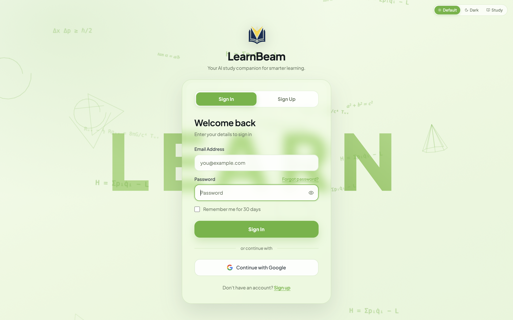](images/auth_screen.png)

*Figure 4.1: LearnBeam Login & Registration Screen.*

### 2. Creating an Account and Logging In
1. **New User Registration:**
   * Click **"Don't have an account? Sign Up"**.
   * Enter your Full Name, university email address, and a secure password (minimum 6 characters).
   * Click **"Create Account"**. A confirmation email may be dispatched based on your authentication settings.
2. **Existing User Sign In:**
   * Enter your registered email address and password.
   * Alternatively, click **"Sign in with Google"** for single-sign-on access.
   * Click **"Sign In"** to load your personal student dashboard.

[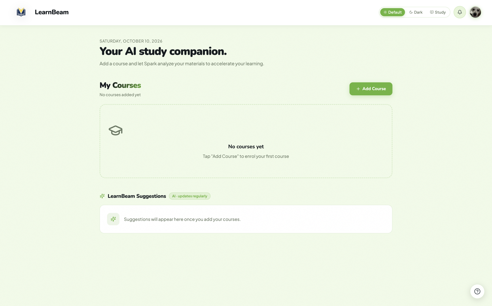](images/dashboard_overview.png)

*Figure 4.2: LearnBeam Student Dashboard with Course Cards and Quick Actions.*

### 3. Setting Up Your First Course
1. Once logged in, click the **"+ Add Course"** button located at the top right of your dashboard.
2. Enter the Course Code (e.g., `CSCE 3600`), Course Title (e.g., `Systems Programming`), Professor's Name, Term/Semester, and choose a theme color.
3. Click **"Create Course"**. The course card will immediately populate on your dashboard grid.
4. Click on the course card to open the complete course workspace.

---

## 5. Features & Functions

---

### Feature 1: Course Dashboard & Workspace Management
**Description:**  
The central hub for all academic activity. Displays active courses, upcoming deadlines, calculated GPA averages, and quick actions to launch focus sessions or upload documents.

**Step-by-Step Execution:**
1. Navigate to the **Dashboard** from the top navigation bar.
2. Review the **Overview Statistics** displaying total courses enrolled, pending assignments, and upcoming deadlines.
3. Click any **Course Card** to access its dedicated course tab bar (Overview, Assignments, Grades, Documents, Activities, and Study Planner).
4. Use the search bar or semester filter to organize archived versus current courses.

| [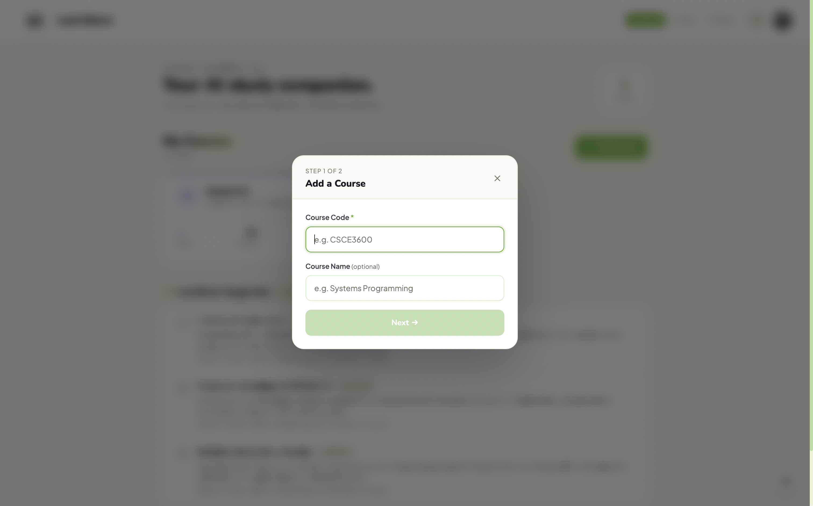](images/feature1_dashboard_grid.png) | [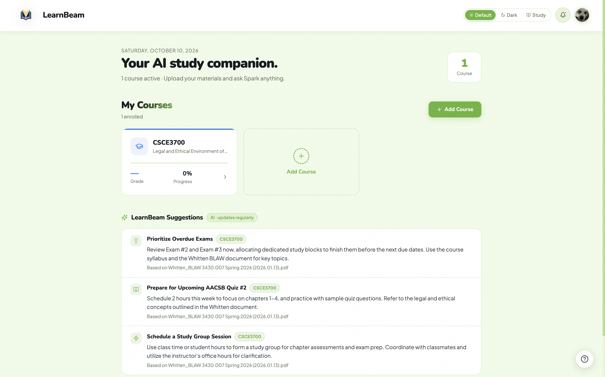](images/feature1_course_details.png) |
| :---: | :---: |
| *Example 1.1: Dashboard displaying enrolled university courses, schedule tags, and completion meters.* | *Example 1.2: Course Card action drawer allowing syllabus upload, quick notes, and color customization.* |

---

### Feature 2: Automated Syllabus Analysis & Schedule Ingestion (Capstone I)
**Description:**  
Students can upload course syllabi in PDF, DOCX, or scanned formats. LearnBeam’s multi-modal extraction engine reads grading weights, exam dates, office hours, and weekly course outlines, automatically populating the course calendar and assignment list.

**Step-by-Step Execution:**
1. Open a course workspace and navigate to the **Overview** or **Documents** tab.
2. Click **"Import Syllabus"** or drag-and-drop your syllabus document into the drop zone.
3. LearnBeam processes the document (using text parsers or vision-assisted canvas OCR for scanned syllabi).
4. Review the extracted course details: course objectives, professor contacts, grading breakdown, and scheduled exams.
5. Click **"Accept & Sync to Course"** to automatically create calendar reminders and assignment entries.

| [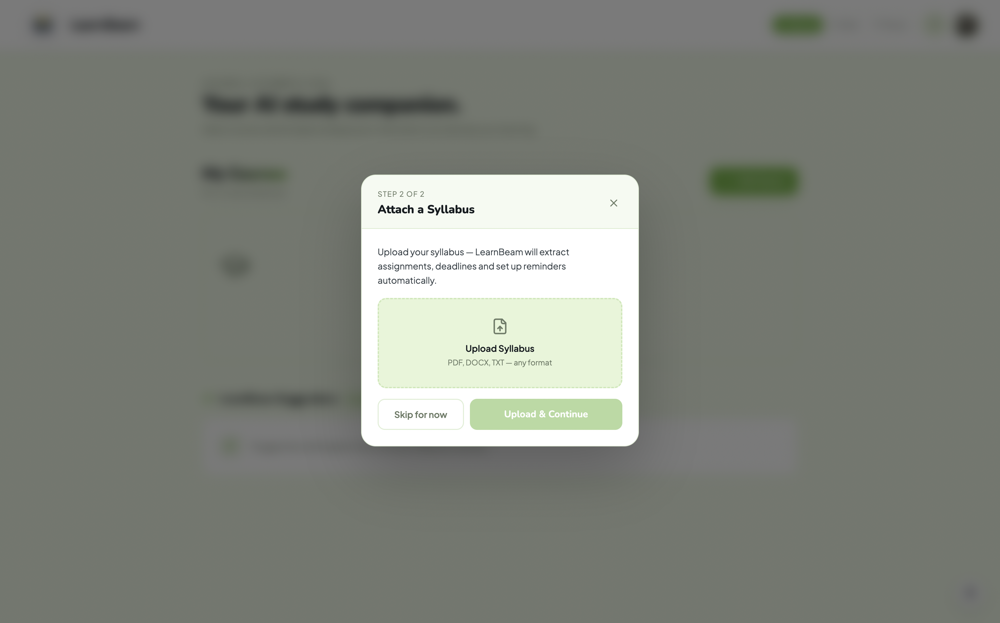](images/feature2_syllabus_upload.png) | [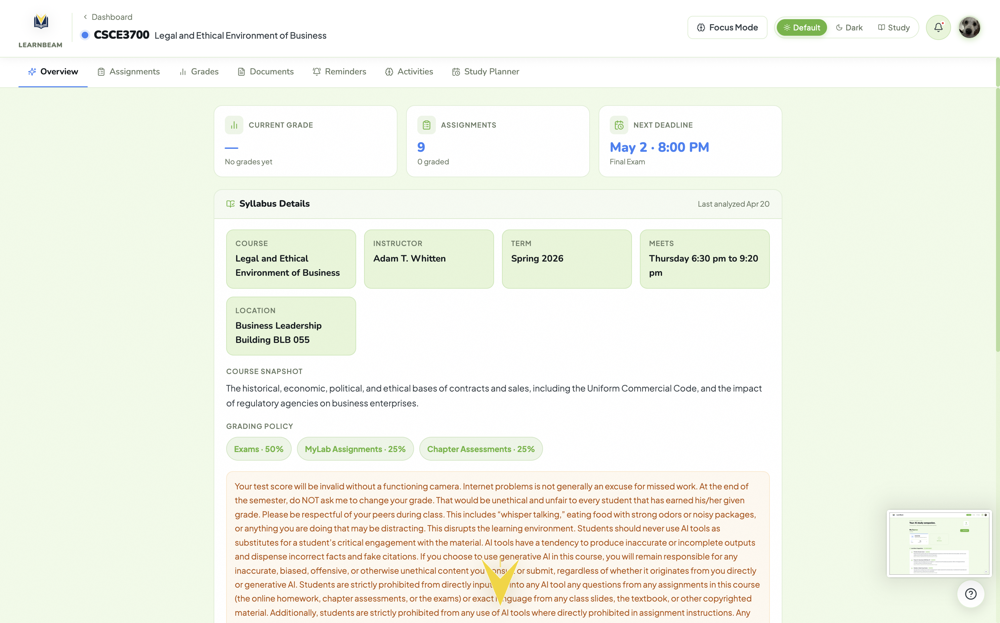](images/feature2_syllabus_results.png) |
| :---: | :---: |
| *Example 2.1: Drag-and-drop syllabus ingestion modal with progress indicator.* | *Example 2.2: Extracted syllabus metadata displaying grading breakdown and schedule milestones.* |

---

### Feature 3: Multi-Format Document Management & OCR Text Extraction
**Description:**  
A full document repository supporting lecture slides (PPTX), Word documents (DOCX), spreadsheets (XLSX), PDFs, and plain text files. Uploaded documents are converted to clean, searchable text snippets stored securely in Supabase Storage.

**Step-by-Step Execution:**
1. Open the **Docs** tab inside any course.
2. Click **"Upload Document"** and select one or more files from your device.
3. View the document list with metadata: file format, upload timestamp, word count, and extraction status.
4. Click on any document row to view the full extracted text preview in a split-screen reader.
5. Use the filter tabs (All, Syllabi, Notes, Readings, Assignments) to categorize your academic library.

| [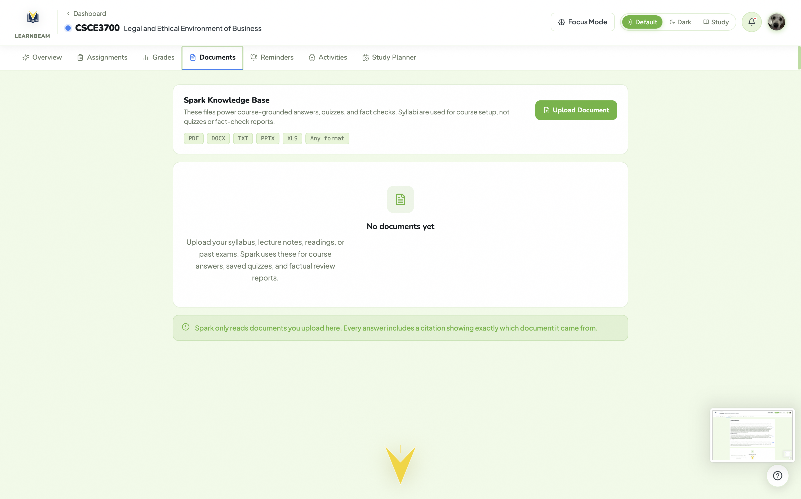](images/feature3_docs_list.png) | [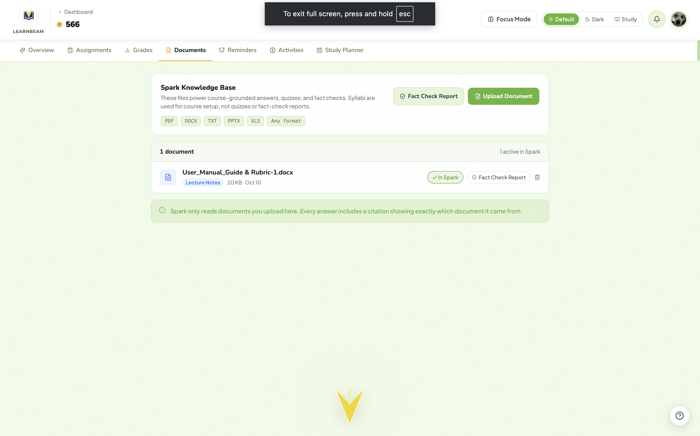](images/feature3_doc_preview.png) |
| :---: | :---: |
| *Example 3.1: Course document library showing categorized files and extraction badges.* | *Example 3.2: Split-screen document viewer displaying raw extracted text ready for AI study.* |

---

### Feature 4: Assignment, Reminder & Grade Tracking
**Description:**  
Provides an interactive tracker for coursework deadlines, homework tasks, midterms, and project submissions with real-time grade weight calculations.

**Step-by-Step Execution:**
1. Click the **Assignments** tab within a course.
2. To create a new assignment, click **"+ Add Assignment"**.
3. Input the Assignment Title, Due Date, Category (Homework, Quiz, Exam, Project), Total Points, and Weight Percentage.
4. As you submit grades, enter your earned score; LearnBeam automatically calculates your cumulative weighted course average.
5. Check off completed assignments to archive them and update your dashboard progress meters.

| [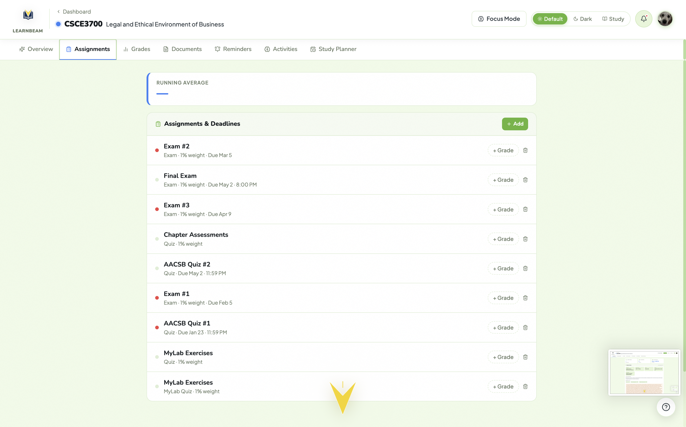](images/feature4_assignments_table.png) | [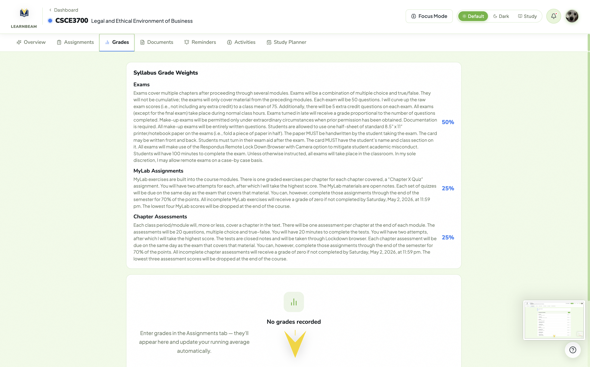](images/feature4_grade_calculator.png) |
| :---: | :---: |
| *Example 4.1: Categorized assignment table with due dates, priority tags, and status checkboxes.* | *Example 4.2: Real-time weighted grade calculation breakdown based on syllabus categories.* |

---

### Feature 5: Spark AI Dual-Mode Study Assistant
**Description:**  
An integrated academic conversational AI designed with rigorous anti-hallucination safeguards. It operates in two distinct modes:
* **Course Sources Mode:** Answers strictly using verified excerpts from uploaded course files with explicit citations.
* **Spark Open Mode:** Operates as a general academic tutor with live web search grounding for concepts not covered in course slides.

**Step-by-Step Execution:**
1. Open the **Spark Chat** panel on the right side of the course workspace.
2. Choose your mode using the toggle button:
   * Select **"Course Sources"** when asking about exam dates, professor policies, or specific lecture slides.
   * Select **"Spark Open"** when asking for broader explanations, math derivations, or coding examples.
3. Type your academic question (e.g., *"What is the late submission policy according to the syllabus?"*).
4. Spark generates a comprehensive answer complete with expandable citation snippets linking back to the source file.

| [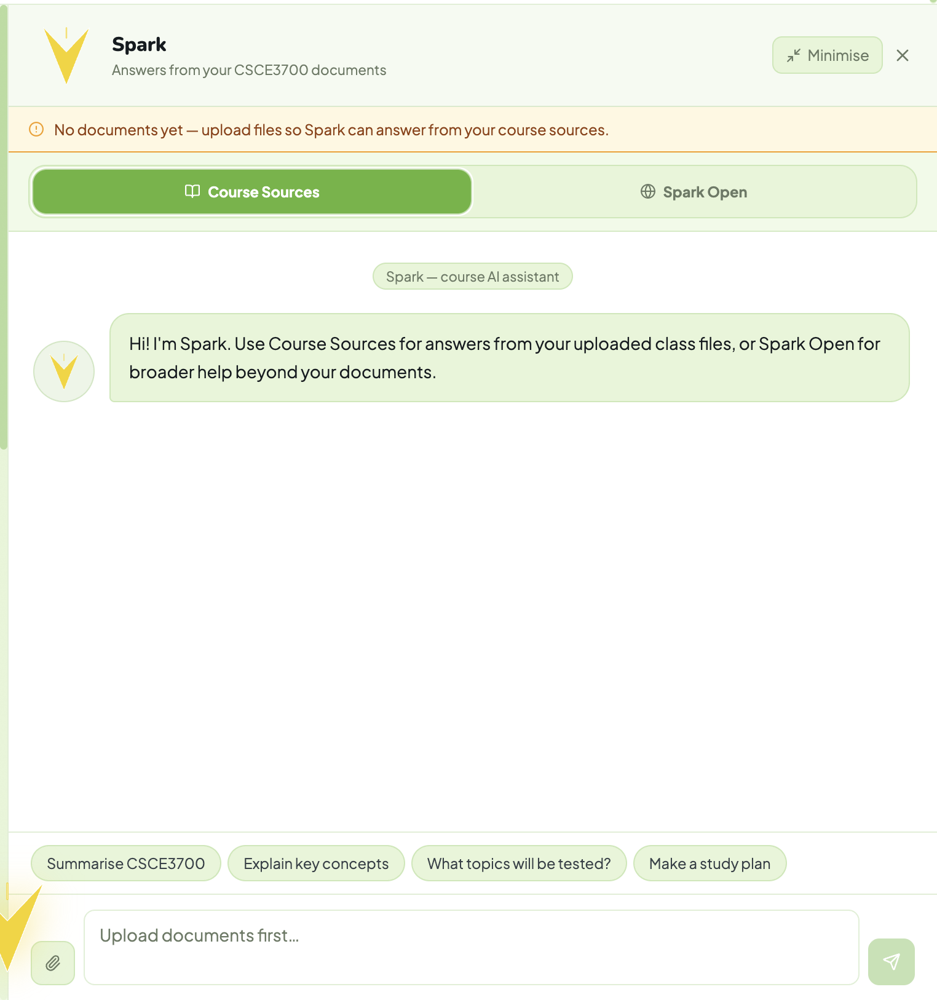](images/feature5_spark_sources.png) | [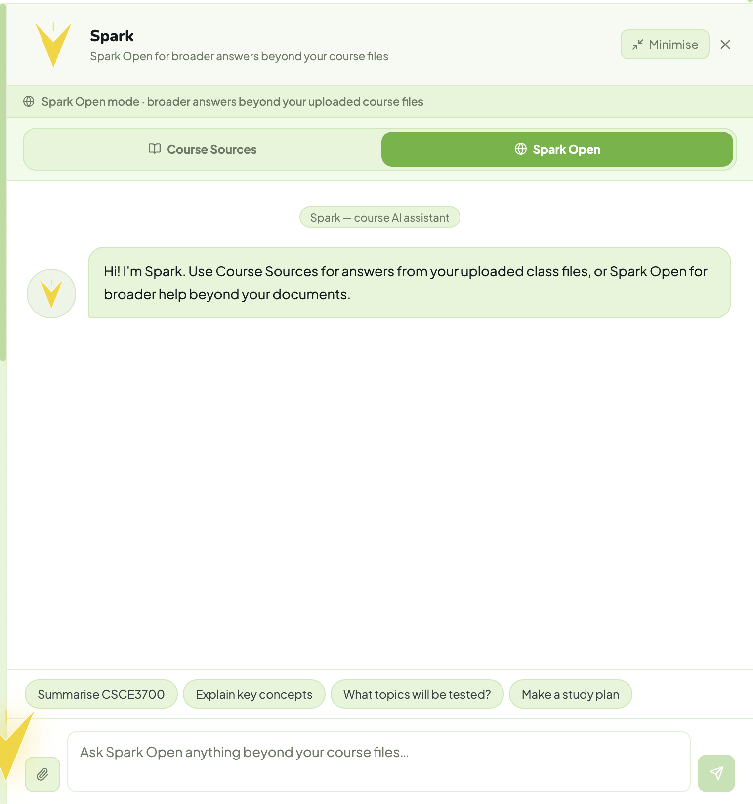](images/feature5_spark_open.png) |
| :---: | :---: |
| *Example 5.1: Spark answering a course-specific policy question with highlighted document citations.* | *Example 5.2: Spark Open mode answering general conceptual queries with web search citations.* |

---

### Feature 6: Smart Study Planner & Adaptive Calendar Export (Capstone II Feature)
**Description:**  
Introduced in Capstone II, the Smart Study Planner uses saved syllabus details, assignments, reminders, course documents, quiz results, and completed focus sessions to build a prioritized weekly study schedule. The plan updates progress as sessions are completed and can be exported as an `.ics` calendar file for Google Calendar, Apple Calendar, or Outlook.

**Step-by-Step Execution:**
1. Navigate to the **Study Planner** tab inside any course.
2. Make sure the course contains useful source information such as a syllabus, readable documents, assignments, reminders, or saved quiz results.
3. LearnBeam automatically builds and saves a weekly plan from the available course records. Click **"Refresh plan"** after changing course information.
4. Review the course-progress chart and the **Covered Topics**, **Uncovered Topics**, and **Need to Study** sections.
5. Select a session in **Your Study Week** or use the **Upcoming Focus** action to mark it complete. The progress chart updates with completed work.
6. Click **"Export calendar"** to download the `.ics` schedule for Google Calendar, Apple Calendar, or Outlook.

| [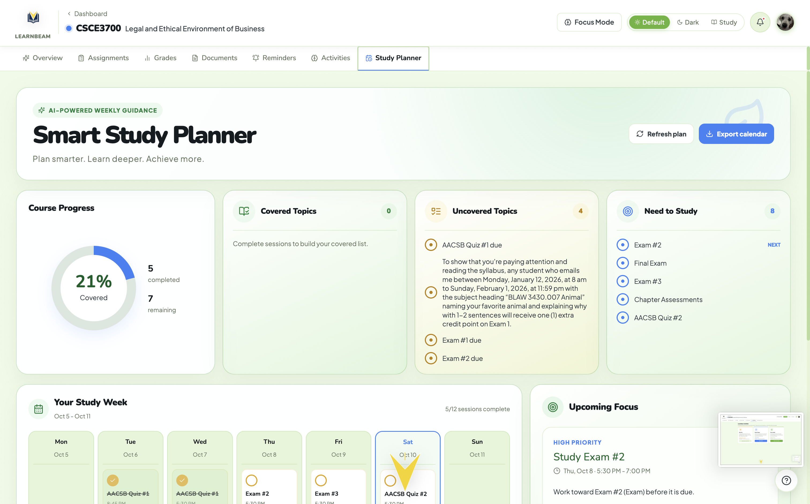](images/feature6_study_planner.png) | [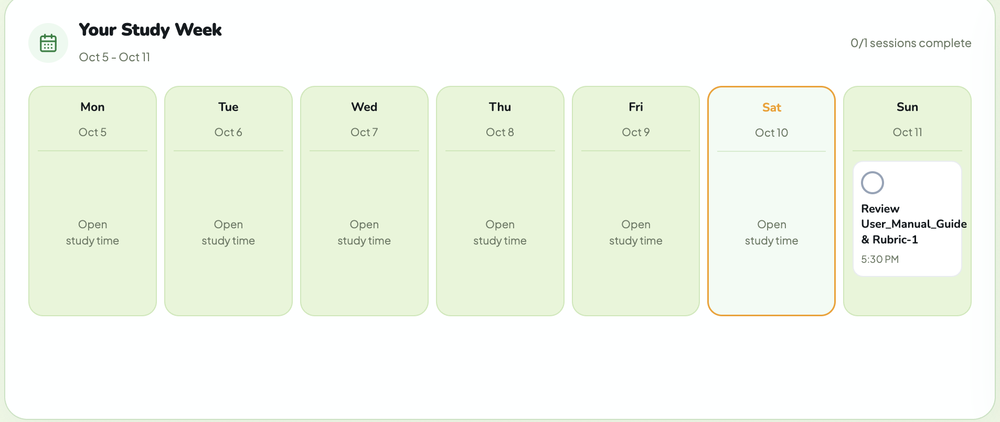](images/feature6_calendar_sync.png) |
| :---: | :---: |
| *Example 6.1: Adaptive study plan showing weekly session blocks and topic coverage.* | *Example 6.2: One-click .ics calendar export dialog with import instructions.* |

---

### Feature 7: AI Quiz Generation & Flash Self-Assessment
**Description:**  
Allows students to test their understanding before exams by generating exactly 10 multiple-choice questions from the active non-syllabus course documents.

**Step-by-Step Execution:**
1. Go to the **Activities** tab in your course.
2. Click on the **"AI Practice Quiz"** card.
3. Choose the target document or topic to test yourself on.
4. Click **"Generate Quiz"**. Spark will create multiple-choice questions with answer choices.
5. Select your answers; the system provides instant feedback with detailed conceptual explanations for correct and incorrect choices.
6. Review your final score and add recommended review topics to your Study Planner.

| [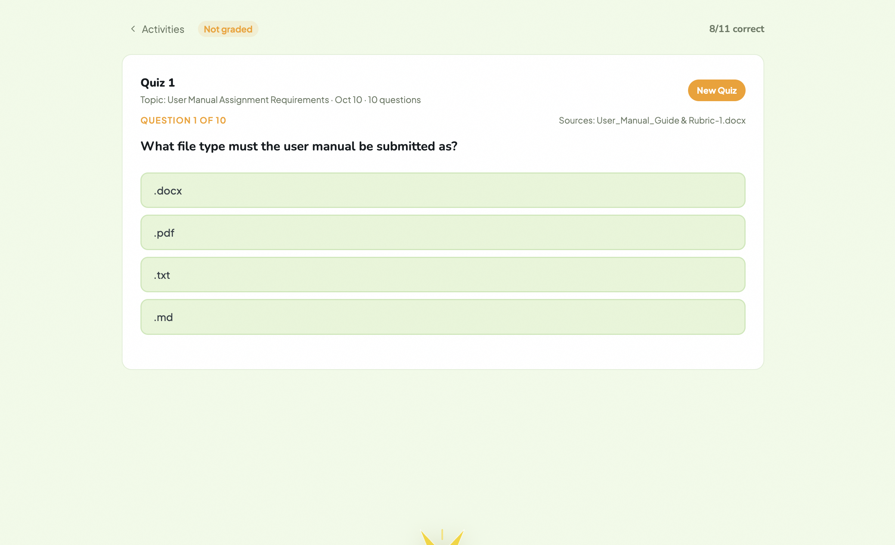](images/feature7_quiz_question.png) | [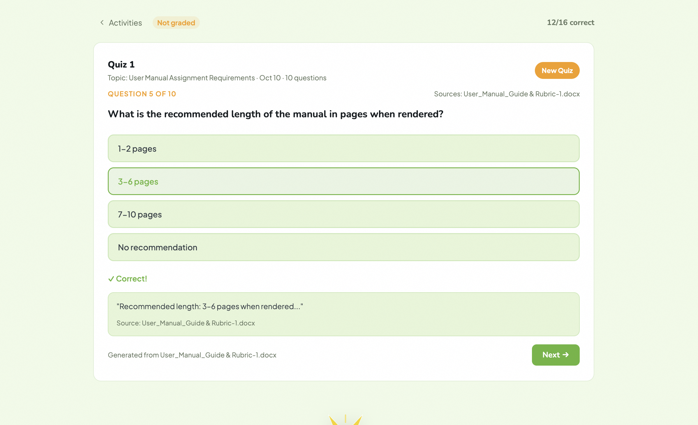](images/feature7_quiz_results.png) |
| :---: | :---: |
| *Example 7.1: Interactive multiple-choice quiz question generated from uploaded lecture slides.* | *Example 7.2: Quiz summary score card showing answer rationales and suggested review areas.* |

---

### Feature 8: Automated Fact-Checking Engine for Study Documents
**Description:**  
Students frequently study from peer notes or unverified online summaries. LearnBeam’s Fact-Check engine parses study notes into individual factual claims and verifies them against authoritative online academic sources.

**Step-by-Step Execution:**
1. In the **Docs** tab, locate an uploaded study guide or summary document.
2. Click the **"Fact Check"** button on the document action row.
3. LearnBeam extracts major factual claims and evaluates each claim using multi-model search verification.
4. The system produces a structured **Fact Check Report** categorizing claims as *Verified*, *Questionable*, or *Unsubstantiated*, with clickable web sources.
5. Save or export the report to ensure you only study verified information.

| [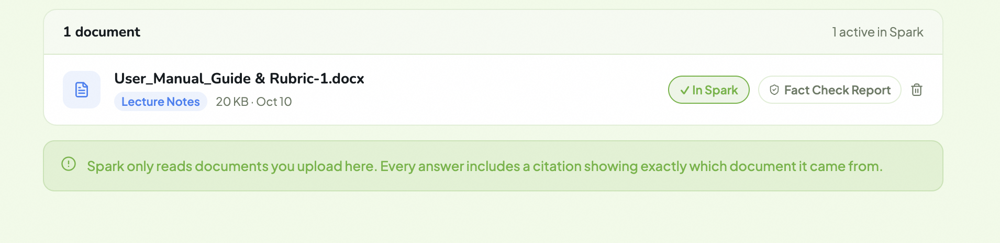](images/feature8_factcheck_running.png) | [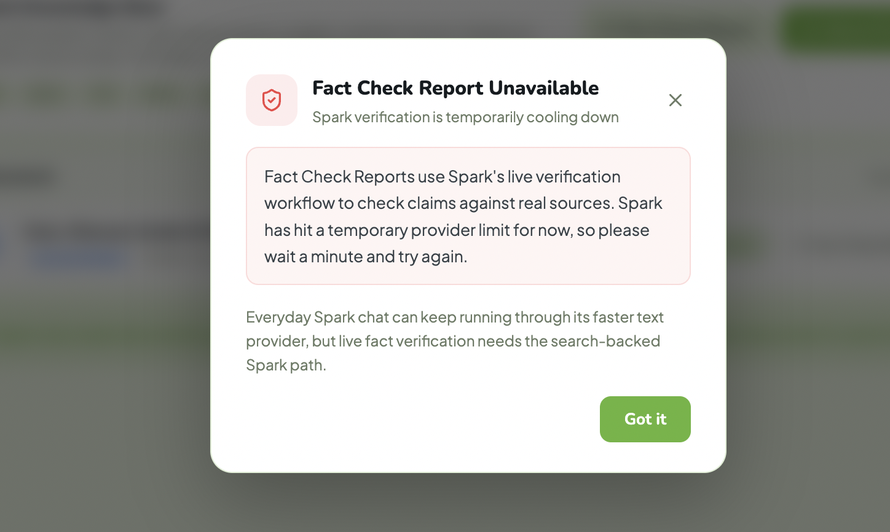](images/feature8_factcheck_report.png) |
| :---: | :---: |
| *Example 8.1: Fact-check scanner extracting verifiable claims from student notes.* | *Example 8.2: Comprehensive verification report displaying claim status and external references.* |

---

### Feature 9: Full-Screen Focus Mode & Pomodoro Study Timer
**Description:**  
A distraction-free study environment featuring a 25-minute focus timer, a 5-minute break timer, pause and reset controls, manual phase switching, and a motivational quote.

**Step-by-Step Execution:**
1. Click the **"Focus Mode"** button located on the top navigation bar or within any course.
2. The browser transitions into an immersive, distraction-free study overlay.
3. Select **25 min Focus** or **5 min Break**.
4. Use the center control to start or pause the countdown. The surrounding controls reset the timer or switch between focus and break phases.
5. Click **"Exit Focus Mode"** when your session is finished.

| [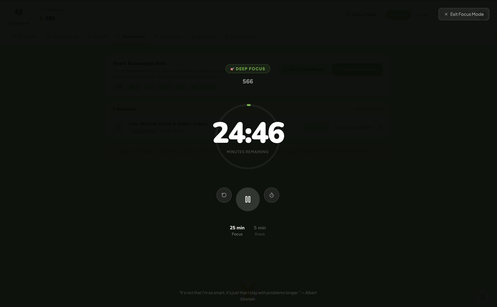](images/feature9_focus_timer.png) | [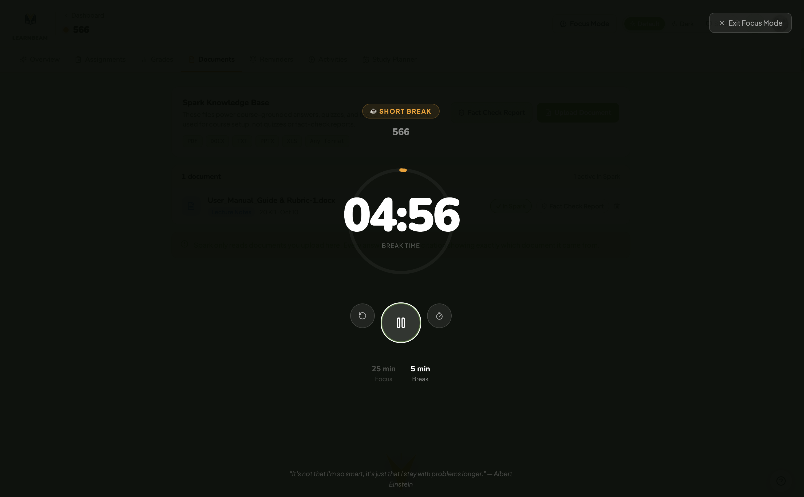](images/feature9_focus_break.png) |
| :---: | :---: |
| *Example 9.1: Distraction-free Pomodoro study timer with circular countdown ring.* | *Example 9.2: Break mode screen featuring motivational quote and rest countdown.* |

---

### Feature 10: User Profile & Visual Theme Customization
**Description:**  
Enables students to manage their profile photo, display name, email address, and switch between the **Default**, **Dark**, and **Study** visual themes.

**Step-by-Step Execution:**
1. Click your avatar icon in the top right corner and select **"Profile"**.
2. To update your photo, click **"Upload Picture"**, choose an image, and save.
3. Select the edit icon beside your display name or email address, enter the updated value, and save it.
4. In the upper right corner, use the **Theme Switcher** to select **Default**, **Dark**, or **Study**.

| [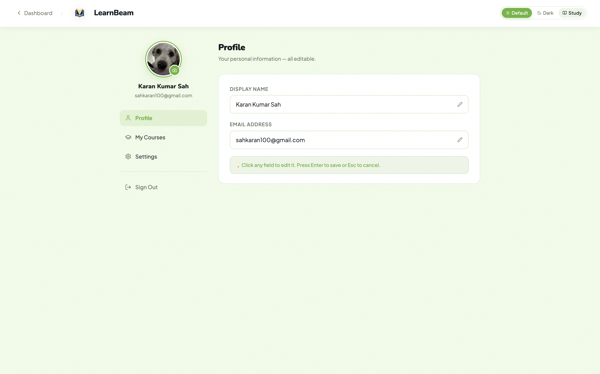](images/feature10_profile_settings.png) | [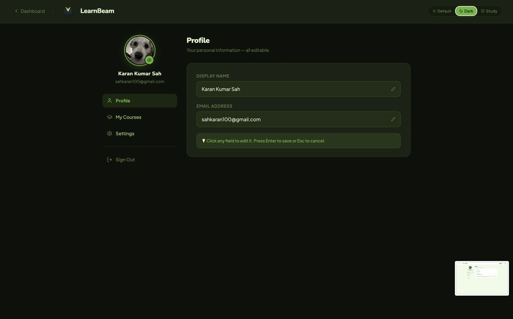](images/feature10_theme_dark.png) |
| :---: | :---: |
| *Example 10.1: Student profile editor with avatar upload and academic statistics.* | *Example 10.2: High-contrast Dark Theme activated for night-time study sessions.* |

---

## 6. Troubleshooting Examples

| Problem | Potential Cause | Recommended Solution |
| :--- | :--- | :--- |
| **Application will not launch locally** | Missing or incomplete `node_modules` dependencies | Run `npm install` in your project directory before executing `npm run dev`. |
| **Login fails with invalid credentials** | Incorrect password, typo in email, or unverified email address | Double-check your spelling, click **"Reset Password"** on the login screen, or check your inbox for the Supabase confirmation link. |
| **Spark AI displays: "Spark is cooling down / rate limit reached" (HTTP 429)** | High query volume exceeded the free-tier API rate limits for Groq or Gemini | Wait 45–60 seconds for the free-tier limit to reset, type `/clear` to reset the chat memory, or toggle from **"Spark Open"** to **"Course Sources"** mode. |
| **An AI provider reports that a model is unavailable** | A configured model identifier is no longer supported or does not match the current provider configuration | Administrators should compare the Supabase Edge Function secrets with `supabase/functions/.env.example`, select a currently supported provider model, and redeploy `spark-ai`. Do not place provider secrets in public `VITE_` variables. |
| **Document upload fails or displays empty text** | Scanned PDF is purely image-based without an embedded text layer | Ensure your scan is high-contrast, or upload the file as a PNG/JPG so LearnBeam's multi-modal vision extractor can OCR the content. |
| **Study plan calendar does not show in Google Calendar** | The `.ics` file was downloaded but not imported into the calendar application | Open Google Calendar in your browser, go to **Settings $\rightarrow$ Import & Export**, select the downloaded `learnbeam_schedule.ics` file, and click **Import**. |
| **Changes to assignments or courses do not appear on second device** | Browser tab has an out-of-sync local cache | Refresh the browser page (`Cmd + Shift + R` or `Ctrl + F5`) to force a fresh data fetch from the Supabase database. |

---

## 7. Contact Information

If you encounter technical issues, have feature requests, or need assistance setting up LearnBeam, please contact the HoloHive development team through the following channels:

* **Support Contact Email:** `RanaAhmadShumail@my.unt.edu`
* **Live Web Application:** [https://learnbeam-five.vercel.app](https://learnbeam-five.vercel.app)
* **Official Project Repository:** [https://github.com/Rana-Shumail/LearnBeam.git](https://github.com/Rana-Shumail/LearnBeam.git)
* **University Showcase:** University of North Texas – Department of Computer Science & Engineering Senior Design Day (Team 10)
* **Bug Reports & Issues:** Submit an issue ticket directly on the [GitHub Issues Tracker](https://github.com/Rana-Shumail/LearnBeam/issues).

---

## 8. Frequently Asked Questions (FAQ & Pro-Tips)

**Q1: How does "Course Sources" mode differ from regular ChatGPT or Gemini?**  
**A:** Standard AI chatbots answer from general web knowledge and frequently hallucinate course deadlines, grading policies, or textbook editions. In **"Course Sources"** mode, Spark AI is restricted strictly to the documents you have uploaded for that course. If a policy is not in your uploaded syllabus, Spark will explicitly inform you rather than guessing.

**Q2: What file formats are supported for document upload?**  
**A:** LearnBeam supports PDF (`.pdf`), Microsoft Word (`.docx`), Microsoft PowerPoint (`.pptx`), Microsoft Excel (`.xlsx`), OpenDocument formats (`.odt`, `.ods`, `.odp`), plain text (`.txt`, `.md`), and common image formats (`.png`, `.jpg`, `.jpeg`, `.webp`).

**Q3: Is my course data private and secure?**  
**A:** Yes. LearnBeam enforces PostgreSQL Row Level Security (RLS) on all database tables and storage buckets. Each student's uploaded documents, assignments, notes, and study plans are strictly accessible only by their authenticated user account.

**Q4: Can I use LearnBeam on my smartphone or tablet?**  
**A:** Yes. LearnBeam is built with responsive mobile styling. You can open [https://learnbeam-five.vercel.app](https://learnbeam-five.vercel.app) on Safari or Chrome on iOS and Android devices to review assignments, run focus timers, and chat with Spark on the go.

**Q5: Pro-Tip: How do I get the best study plan from the Smart Study Planner?**  
**A:** Upload your syllabus first and make sure your major assignment deadlines are entered in the **Assignments** tab. The planner uses these target dates to mathematically distribute your study sessions, ensuring you peak right before midterms and finals without cramming.

**Q6: Pro-Tip: What should I do if a chat conversation gets too slow or hits token limits?**  
**A:** Simply type `/clear` into the Spark chat box and hit Enter. This clears the in-memory chat transcript and starts a fresh, high-speed conversation context while preserving all your saved notes and course documents.
